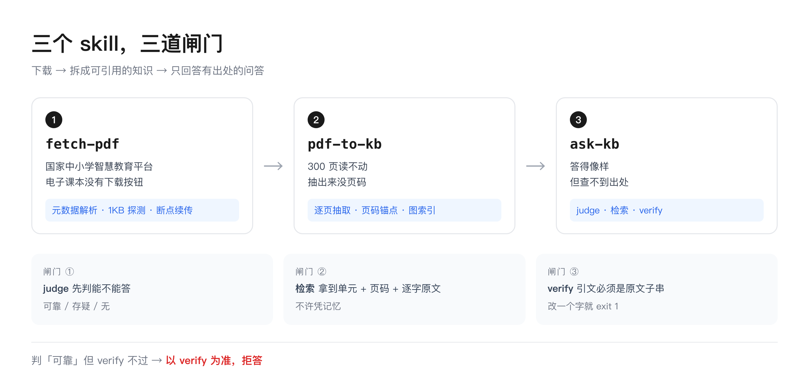
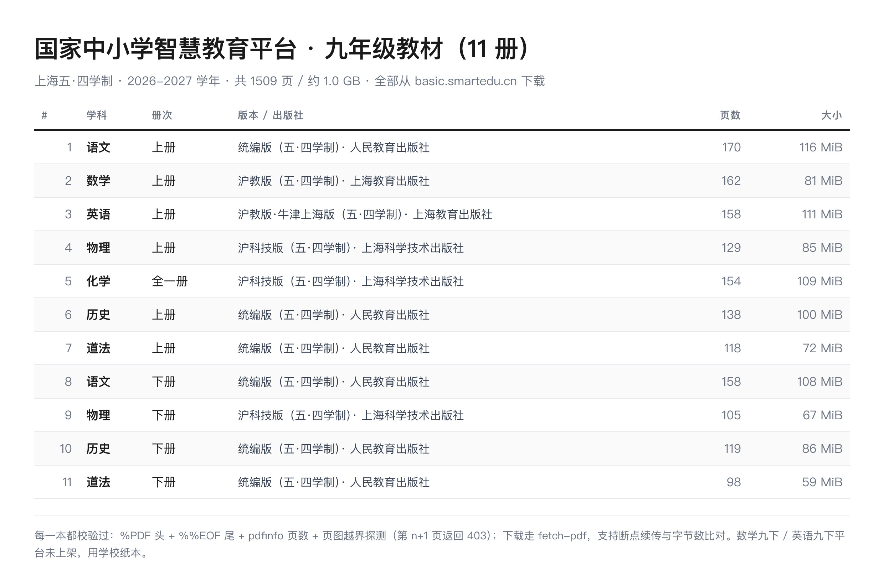
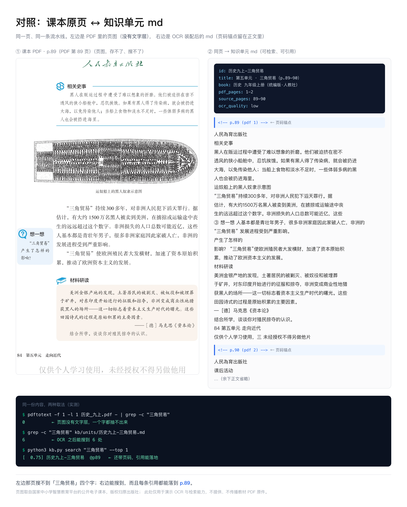
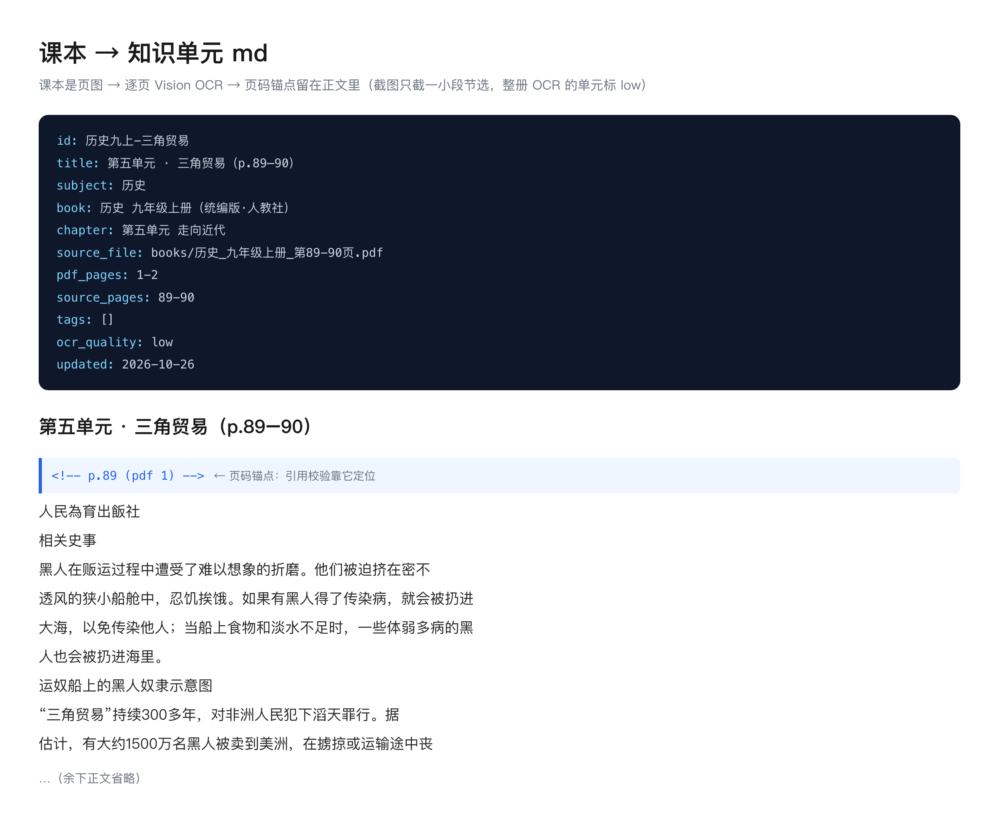
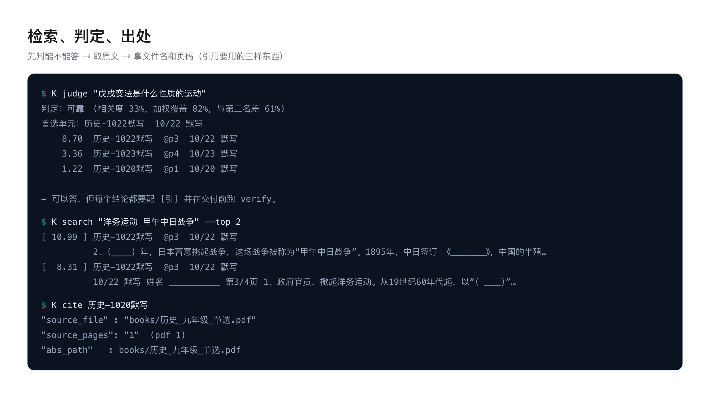
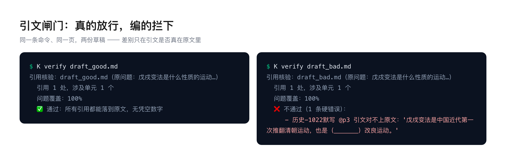
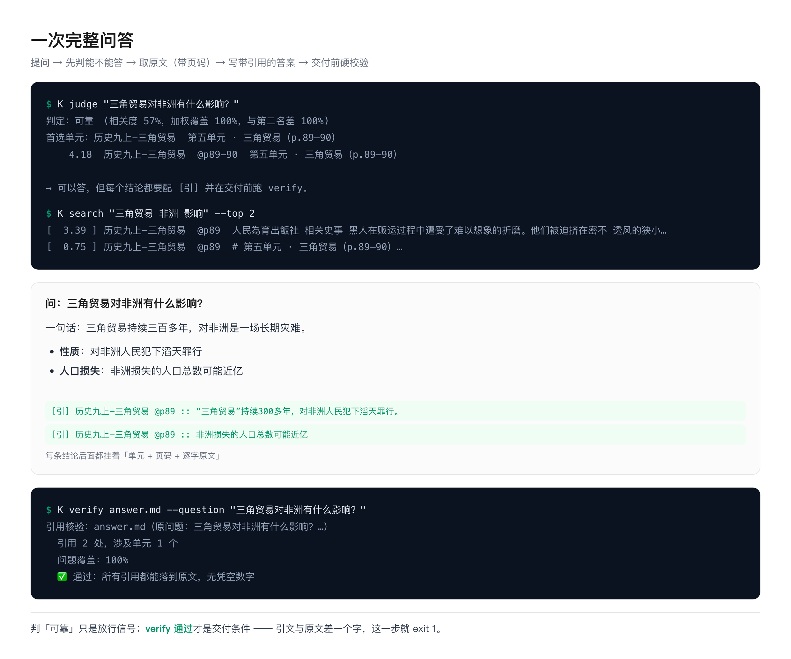

# cn-k12-textbook-skills

## 中国中小学教材 · AI 技能系列

`https://github.com/yuna78/cn-k12-textbook-skills`

> **给「国家中小学智慧教育平台」的教材，做一个本地学科知识库。**
>
> 平台电子课本没有下载按钮、要登录；一本 300 页读不动、抽出来没页码；问 AI 又查不到出处。
> 三个 skill 分别对付一件事：

| 平台上的问题 | 用哪个 skill |
|---|---|
| 电子课本只能在线翻、没有下载按钮，链接一探就 401 | [`fetch-pdf`](skills/fetch-pdf/SKILL.md) |
| 300 页读不动；OCR 出来没页码，问细节只能含糊 | [`pdf-to-kb`](skills/pdf-to-kb/SKILL.md) |
| 答得像模像样但查不到出处，甚至会编 | [`ask-kb`](skills/ask-kb/SKILL.md) |

串成一条线：**把「国家中小学智慧教育平台」（`basic.smartedu.cn`）的电子课本，
变成可检索、可引用、可打印的本地学科知识库。**

```
┌─────────────┐     ┌──────────────────┐     ┌──────────────────┐
│  fetch-pdf  │ ──> │    pdf-to-kb     │ ──> │     ask-kb       │
│  拿到 PDF    │     │ 单元md+页码+图索引 │     │ 检索 + 三道闸门    │
└─────────────┘     └──────────────────┘     └──────────────────┘
```

| 项目 | 说明 |
|---|---|
| **主要来源** | [国家中小学智慧教育平台](https://basic.smartedu.cn)（教育部，`basic.smartedu.cn` / `ykt.cbern.com.cn`）电子课本、教材 PDF |
| 也支持 | 任意直链 PDF、本地已有 PDF（讲义、讲评、答案册、老师发的资料） |
| 教材版本 | 人教版 / 沪教版 / 统编版 / 沪科技版；五·四学制与六·三学制均可；语数英理化史道法都行 |
| 运行环境 | **Claude Code / Codex / WorkBuddy** 等能跑 bash 的 agent；也可纯命令行使用 |
| 依赖 | python3 + poppler；扫描件另需 OCR（可插拔） |
| License | MIT |

> **PDF in, cited answers out.** —— 下载进来的是 PDF，交出去的是带页码出处的答案。

## 快速开始

```bash
# 依赖：python3 + poppler（pdftotext/pdftoppm/pdfimages/pdfinfo）
# macOS: brew install poppler          Ubuntu: apt install poppler-utils
# 扫描件另需 OCR：brew install tesseract tesseract-lang（或用 --ocr-cmd 接自己的）

git clone https://github.com/yuna78/cn-k12-textbook-skills.git cn-k12-textbook-skills && cd cn-k12-textbook-skills

# ① 下载（公开直链；需要登录的资源见 skills/fetch-pdf）
python3 skills/fetch-pdf/scripts/fetch.py "https://example.com/book.pdf" -o books/book.pdf --resume

# ② 逐页抽文本 → 切单元 → 抽图 → 建索引
python3 skills/pdf-to-kb/scripts/extract.py books/book.pdf --out work/
python3 skills/pdf-to-kb/scripts/segment.py --work work/ \
        --manifest examples/manifest.example.json --out kb/
python3 skills/pdf-to-kb/scripts/figures.py --pdf books/book.pdf --work work/ --kb kb/
python3 skills/pdf-to-kb/scripts/build.py --kb kb/ --verify

# ③ 问问题（带出处；交付前过闸门）
K="python3 skills/ask-kb/scripts/kb.py --kb kb"
$K judge  "水的净化有哪几种方法"
$K search "净化 过滤 蒸馏" --top 6
$K verify drafts/answer.md --question "水的净化有哪几种方法"
```

## 三个 skill

| Skill | 解决什么 | 关键设计 |
|---|---|---|
| [`fetch-pdf`](skills/fetch-pdf/SKILL.md) | 页面没有下载按钮、下下来只有半截、需要登录态（**已适配国家中小学智慧教育平台**） | 元数据解析 → 直链探测（200/206/401）→ 断点续传 + 头尾校验；登录态资源**在页面内**取数，凭证永不出浏览器 |
| [`pdf-to-kb`](skills/pdf-to-kb/SKILL.md) | 几百页 PDF 不能检索、引用不到页 | 逐页抽取（文字层优先、扫描件 OCR）→ 按章切带 frontmatter 的 md → 抽图并对图号图题 → 建 chunk 索引 |
| [`ask-kb`](skills/ask-kb/SKILL.md) | 答得像但会编、找不到出处 | 零依赖 BM25（中文二元组）→ `judge` 判能不能答 → `verify` 硬校验每条引文是否真在原文 |



### fetch-pdf：三条路，先探测再动手

```
直链 200/206 ──────────────────────> fetch.py（断点续传 + %PDF/%%EOF/字节数校验）
页面无下载按钮 ──> resolve 元数据 ──> 真实 URL ──┬── 401/403 ──> 页面内 fetch（MAC/Bearer 签名）
                                              └── 200/206 ──> fetch.py
```

已适配：国家中小学智慧教育平台（教材，元数据在公开镜像、文件在私有 CDN）。
其它站点只需替换两个函数（`readToken()` / `authHeader()`），见
[references/sources.md](skills/fetch-pdf/references/sources.md)。

真下下来的一批（11 册 / 1509 页 / 约 1.0 GB，每本都过了页数与字节数校验）：



### pdf-to-kb：页码是第一优先级

每页单独抽、每页留标记，单元 md 里长这样：

```markdown
---
id: 化学九上-第四单元
source_file: books/化学九上.pdf
pdf_pages: 88-113        # PDF 物理页
source_pages: 78-103     # 书上印刷页
ocr_quality: high
---

<!-- p.78 (pdf 88) -->
（该页正文）
```

`<!-- p.N -->` 不是装饰 —— `verify` 靠它把「页」落成具体一段文字。
没有页码的知识库，等于没有出处。

课本是页图、没有文字层时，先 OCR 再按页装配。左边是原页，右边是同页出来的 md：



同一份 md 放大看：frontmatter + 页码锚点 + 正文，锚点和内容按页对齐：



### ask-kb：三道闸门，宁可拒答

| judge | 允许怎么答 |
|---|---|
| 可靠 | 正常答 + 每条 `[引] unit @p页 :: 原文` + verify 通过 |
| 存疑 | 列候选、逐条给页码，不许下单一结论 |
| 无 | 只能说"本地资料没有"；给常识必须标 `⚠️ 非本地资料` |

引文必须**逐字**是原文子串（去空白标点后比对）；**判可靠但 verify 不过 → 以 verify 为准拒答**。

三个命令各拿什么（真实输出）：



同一条 `verify`、同一页，两份草稿 —— 差别只在引文是否真在原文里：



一条问答走完全程（判定 → 检索 → 带引用的答案 → 闸门通过）：



## 实测

在作者自己的项目上（一套初中教材 + 老师资料的知识库）：

| 指标 | 结果 |
|---|---|
| 知识库规模 | 609 个单元 / 563 条图索引 |
| Recall@1（问到对的地方） | **97.4%** |
| 误拒率（库里有却判无） | **0%** |
| 拒答准确率（库里没有时老实说没有） | **100%** |
| 引用闸门（引文能落到原文） | **12/12** |

本仓库自带评估脚本，换你自己的库可以直接跑：

```bash
python3 skills/ask-kb/scripts/eval.py --kb kb/ --set examples/eval.example.json --verbose
```

## 设计取舍（为什么不用向量库）

| 选择 | 理由 |
|---|---|
| **BM25 + 中文二元组** | 教材/资料的问题关键词明确（"图12-4-1""赤壁之战"），几千 chunk 规模下 BM25 又快又准；零依赖、离线、可解释、能定位到页。需要语义检索时 `chunks.jsonl` 就是干净的接入点 |
| **一页一文件** | 页码是引用的最小单位；整本抽取后再定位页码要重做，代价更高 |
| **图单独索引** | 图里的字 OCR 基本抓不到，但"图号 → 页 → 图片"能做到，就能把原图给用户而不是猜 |
| **闸门而不是提示词** | "请不要编造"写在 prompt 里不可验证；`verify` 是程序，给了 exit code |

## 目录结构

```
skills/
  fetch-pdf/     SKILL.md + scripts/(fetch.py, resolve_smartedu.py, fetch_in_page.js)
                 + references/sources.md      ← 平台解析的备选路径与失效对照
  pdf-to-kb/     SKILL.md + scripts/(extract.py, segment.py, figures.py, build.py)
                 + references/schema.md       ← 单元 md 的 frontmatter 与页码规则
  ask-kb/        SKILL.md + scripts/(kb.py, eval.py)
                 + references/gates.md        ← 三道闸门的判定细节
examples/        README.md（怎么跑）+ manifest/eval/draft 三个样例 + vision_ocr.swift
docs/            architecture.md（数据流与失败模式）+ material/（README 配图，见其 README）
LICENSE           MIT
.gitignore       排除 books/ work/ kb/ *.pdf —— 教材与中间产物不进仓库
```

## 怎么装进你的 Agent

脚本是**纯 CLI**，任何能跑 bash 的 agent 都能用；`SKILL.md` 只是给 agent 看的说明书。
三种接法按你的环境选：

| 环境 | 接法 |
|---|---|
| **Claude Code** | 放进 `~/.claude/skills/`（用户级）或项目 `.claude/skills/`，自动识别 `SKILL.md` |
| **Codex**（OpenAI Codex CLI） | 把 `SKILL.md` 里"命令怎么跑"那段写进仓库根的 `AGENTS.md`，或作为自定义指令加载；脚本照常 `python3` 调用 |
| **WorkBuddy** | WorkBuddy 的技能就是 `<skill-name>/SKILL.md` 结构（[官方说明](https://workbuddy.homes/bluebook/)），与本仓库一致——把 `skills/` 下三个目录整个拷进它的技能目录即可 |
| 其它 agent / 自己用 | 直接当命令行工具，三条命令串成流水线 |

```bash
git clone https://github.com/yuna78/cn-k12-textbook-skills.git && cd cn-k12-textbook-skills

cp -r skills/* ~/.claude/skills/            # Claude Code 用户级
cp -r skills/* <your-project>/.claude/skills/   # Claude Code 项目级
cp -r skills/* <your-project>/.agents/skills/   # 支持 .agents/skills 约定的 agent
```

> 三个 skill 都是 `<skill-name>/SKILL.md + scripts/` 的标准结构，Claude Code 与 WorkBuddy
> 都按这个约定加载，无需改任何文件；Codex 只吃 `AGENTS.md`，把命令段落搬过去就行。
>
> 不装 skill 也能用：`SKILL.md` 里的命令原样复制到终端即可。

## 跨平台（Windows / Linux）

脚本是纯 Python（无第三方包），平台差异只在两个**外部命令行工具**和 **OCR 引擎**：

| 依赖 | macOS | Windows | Linux |
|---|---|---|---|
| poppler（`pdftotext` / `pdftoppm` / `pdfinfo`） | `brew install poppler` | 下 [poppler-windows](https://github.com/oschwartz10612/poppler-windows/releases) 发行包，把 `bin\` 加进 `PATH` | `apt install poppler-utils` |
| OCR 引擎 | **不用装**，系统自带 Vision（见下） | tesseract：[UB-Mannheim 安装包](https://github.com/UB-Mannheim/tesseract/wiki)，勾选 **Chinese (Simplified)** | `apt install tesseract-ocr tesseract-ocr-chi-sim` |

```powershell
# Windows（PowerShell）—— 先确认依赖在 PATH 里
pdftotext -v
tesseract --version

# ① 有文字层的 PDF：直接抽
python skills\pdf-to-kb\scripts\extract.py books\历史.pdf --out work\历史 --ocr none

# ② 扫描件（无文字层）：走 tesseract
python skills\pdf-to-kb\scripts\extract.py books\历史.pdf --out work\历史 `
       --ocr auto --ocr-lang chi_sim+eng
```

三个平台行为一致的原因：`--ocr-cmd` 模板里**没有 shell 元字符时，脚本直接调用二进制**
（不经过 shell 解析），所以 `tesseract {img} {out} -l chi_sim` 在 cmd / PowerShell / bash 下等价。
真要写重定向（`myocr {img} > {out}`）时，脚本会自动切换到平台 shell（`cmd /c` 或 `bash -lc`）。

Windows 上几个容易踩的点：

- **别在 `--ocr-cmd` 里写重定向**，直接给命令即可（见上）
- 中文路径 / 中文输出：先 `chcp 65001`，或设环境变量 `PYTHONUTF8=1`
- Apple Vision 是 macOS 专有。想要同样质量，Windows 可以接自己写的适配器：
  `--ocr-cmd "python C:\tools\vision_ocr.py {img} {out}"`（脚本只要求「读图 → 写 <out>.txt」）
- `kb.py` / `segment.py` / `build.py` / `figures.py` 无平台依赖，Windows 原样能跑

### macOS：用系统自带的 Vision 做 OCR（推荐，不用装任何东西）

**Vision 是什么**：苹果系统里的图像分析框架（`Vision.framework`），其中 `VNRecognizeTextRequest`
就是文字识别。它是 **macOS 自带的能力，不是第三方软件**——不用装、不联网、不花钱，
macOS 10.15+ 都有。识别在你的机器上本地完成，图片不会离开本机。

**为什么拿它做教材**：印刷体中文识别质量明显好于 tesseract，速度还快一倍；
按 250 dpi 渲染页图后，小字（页脚、图注、图里的标注）也能抓到。

**它的问题**：Vision 只有框架，**没有命令行工具**。所以本仓库带了一个 50 行的 Swift 包装：
[`examples/vision_ocr.swift`](examples/vision_ocr.swift)（用 `swiftc` 编译一次即可）。

```bash
# 编译（约 3.6 秒，产物 87 KB；需要 Xcode 命令行工具：xcode-select --install）
swiftc -O -o bin/vision_ocr examples/vision_ocr.swift

# 单张试一下
bin/vision_ocr page.png

# 接到流水线里（这是个普通 CLI，按 --ocr-cmd 的 {img}/{out} 约定用）
python3 skills/pdf-to-kb/scripts/extract.py books/历史.pdf --out work/历史 \
        --ocr auto --ocr-cmd "$(pwd)/bin/vision_ocr {img} > {out}"
```

那个 Swift 文件里做了三件关键的事（自己写适配器时照抄）：

1. `recognitionLevel = .accurate` + `recognitionLanguages = ["zh-Hans", "en-US"]`
2. `usesLanguageCorrection = true`、`minimumTextHeight = 0.005`（小字不丢）
3. **把 Vision 返回的「文本块」按 y 坐标聚类成行再排序** —— 不做这一步，中文正文会被打碎成乱序碎片，
   这是直接调 Vision 最容易踩的坑

**局限**：只出纯文本，不保留表格/分栏结构；公式与上下标会退化；**Windows / Linux 用不了**（没有 Vision），
那两个平台用 tesseract，或自己接 RapidOCR / PaddleOCR（同样只要满足「读图 → 写 `<out>.txt`」）。

### OCR 两个引擎的实测对比（同一份 2 页课本，人教版历史九上 p.89–90）

| 引擎 | 汉字数 | 噪音行 | 耗时（含 250 dpi 渲染） | 典型错字 |
|---|---|---|---|---|
| macOS Vision（系统内置） | 748 | 0 | **5.3 s / 2 页**（≈2.6 s/页） | 无 |
| tesseract 5.5.3 + `chi_sim`(fast) | 674 | 9 | **10.7 s / 2 页**（≈5.4 s/页） | 「忍饥挨饿」→「忍饥换俄」 |

- 汉字级相似度 **90.2%**（以 Vision 为基准）；关键短语「三角贸易 / 滔天罪行 / 非洲 / 人口总数」两边都命中，
  tesseract 漏了「运奴船」，且在页眉水印处产生了 9 行英文乱码
- 结论：**Mac 上用 Vision**（快一倍、干净）；**Windows 上用 tesseract 完全可用**，但要多留一道人工核对
- tesseract 默认只带 `eng`，中文包单独装：

```bash
# macOS：中文包单独拉（约 2.4 MB）
curl -sL "https://raw.githubusercontent.com/tesseract-ocr/tessdata_fast/main/chi_sim.traineddata" \
     -o "$(brew --prefix tesseract)/share/tessdata/chi_sim.traineddata"
# Windows：UB-Mannheim 安装时勾选 Chinese (Simplified) 即可
```

## 局限（先说清楚）

- **OCR 引擎可换，不是绑死的**：`--ocr-cmd` 接任意引擎。macOS 用**系统自带 Vision**
  （不用装软件，仓库带 50 行 Swift 包装 `examples/vision_ocr.swift`，`swiftc` 编译即用；实测
  11 册 / 1509 页 / 843,595 字 / 0 失败，含渲染约 **2.5 s/页**）；Windows / Linux 用 tesseract
  （实测约 5.4 s/页、汉字相似度 90.2%，见[「跨平台」](#跨平台windows--linux)的对比表）
- **OCR 质量决定上限**：`ocr_quality: low` 的单元，引用时必须提示"OCR 可能有误，请对纸质书"
- **不保留版式**：表格/公式只抽文本，复杂版面会退化
- **平台接口是逆向的**：smartedu 的私有 CDN 签名方案随时可能变；只应下载你有权访问的内容
- **闸门不是万能**：它保证"引文真实存在于原文"，不保证"原文本身是对的"（错题答案、OCR 误字仍需人工判断）

## 边界与合规

- 只处理**你自己提供、且你有权访问**的文件（国家中小学智慧教育平台的电子课本属公开阅读内容，下载后仅供个人学习，不要再分发）
- 不绕过付费墙、不破解 DRM、不批量爬站
- **不随仓库分发任何受版权保护的原文**（教材、讲义等请自行获取，勿提交）
- 下载后的内容仅供个人学习使用

## License

MIT（见 [LICENSE](LICENSE)）。脚本可自由用于商业项目；**你的数据与下载内容不在授权范围内**。

## 文档与配图

- 架构与数据流：[docs/architecture.md](docs/architecture.md)
- README 里的配图：[docs/material/](docs/material/) —— 都是跑真实流水线后截图，
  改了代码重跑 `docs/material/make_material.py` 即可同步更新

| 图 | 内容 |
|---|---|
| [`01-教材目录`](docs/material/01-教材目录.png) | 真下载的 11 册清单（页数/大小/版本） |
| [`02-课本知识单元`](docs/material/02-课本知识单元.png) | 课本 OCR 出来的单元 md（frontmatter + 页码锚点） |
| [`03-检索与引用`](docs/material/03-检索与引用.png) | `judge` / `search` / `cite` 真实输出 |
| [`04-闸门对比`](docs/material/04-闸门对比.png) | 正确引用通过 vs 编造引用被拦下 |
| [`05-流程与闸门`](docs/material/05-流程与闸门.png) | 三个 skill + 三道闸门结构图 |
| [`06-课本页对照md`](docs/material/06-课本页对照md.png) | 课本原页 vs 同页 md，附实测证据条 |
| [`07-完整问答`](docs/material/07-完整问答.png) | 一次完整问答：judge → search → 带引用答案 → verify |

## 关键词

方便搜到：中国中小学教材 · 国家中小学智慧教育平台 · 电子课本 · 初中九年级 · 教材下载 ·
PDF 转 Markdown · 学科知识库 · 带页码出处 · 引用校验 · 本地 RAG · OCR 扫描件 · Agent Skill。
